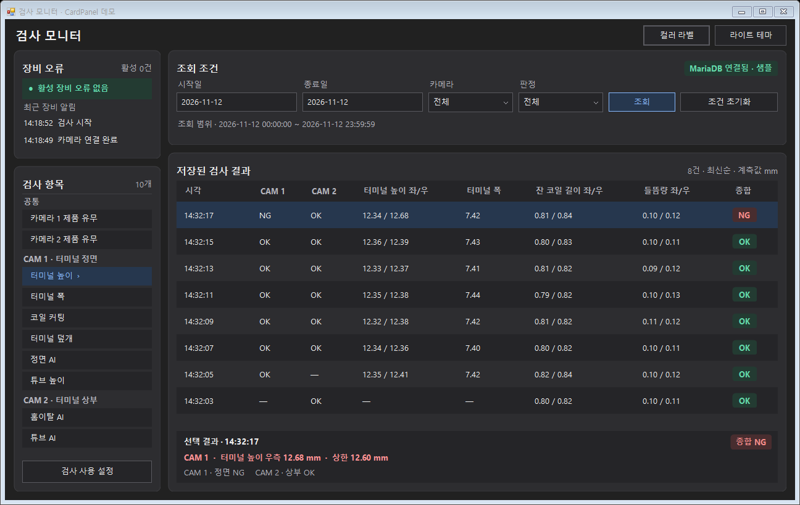

# CardPanel (카드 패널)

검사 화면에서 조회 조건, 장비 알림, 검사 결과처럼 서로 다른 컨트롤을 둥근 테두리 안에 묶는다. 표준 WinForms `Panel`을 상속하므로 기존 `GroupBox`의 본문처럼 컨트롤을 넣고, 제목·중앙 문구·건수를 헤더에 표시할 수 있다.

## 결과 화면



## 설치 및 디자이너 사용

1. `OmniSight.UI.sln`을 **Release | x64**로 빌드한다. 출력은 `src/OmniSight.UI/bin/x64/Release/net472/OmniSight.UI.dll`이다.
2. 소비 앱의 .NET Framework 4.7.2 WinForms 프로젝트에서 이 DLL을 참조하고 플랫폼을 `x64`로 맞춘다.
3. 폼 디자이너에서 **도구 상자 → 항목 선택 → .NET Framework 구성 요소 → 찾아보기**로 DLL을 선택한다. `CardPanel`을 폼에 놓는다.
4. 속성 창의 **OmniSight** 범주에서 테마, 헤더 문구, 테두리를 설정한다. 카드 안에 `TableLayoutPanel`을 배치하고 `Dock = Fill`로 설정하면 헤더 아래 공간에서 자식 컨트롤을 정렬할 수 있다. 스크롤할 본문에는 `AutoScroll = true`인 일반 `Panel`을 넣는다.

## 속성

| 속성 | 동작과 기본값 |
| --- | --- |
| `HeaderLeftText` | 왼쪽의 굵은 제목. 기본값은 빈 문자열 |
| `HeaderCenterText` | 카드 기준으로 가운데 정렬하는 문구. 기본값은 빈 문자열 |
| `HeaderRightText` | 오른쪽의 건수나 상태. 기본값은 빈 문자열 |
| `HeaderRightStyle` | 기본 `Text`는 보조 텍스트, `SuccessBadge`는 녹색 연결 배지 |
| `Theme` | 공용 `UiTheme.Dark` 또는 `UiTheme.Light`. 기본값은 `Dark` |
| `CornerRadius` | 96 DPI 기준 반경. 기본 9px이며 0은 직각 |
| `ShowHeaderDivider` | 헤더 아래 구분선. 기본값은 `false` |
| `Padding` | 헤더와 본문의 공통 여백. 기본 14px |

세 헤더가 비어 있으면 본문이 그 공간까지 사용한다. 문구 하나만 설정하면 헤더 전체 폭에서 해당 위치에 정렬한다. 여러 문구를 설정하면 각 영역을 확보하고, 넘치는 문구는 말줄임표로 표시한다. 카드 모서리 바깥은 부모의 단색 배경에 맞춘다.

## 코드에서 만들기

```csharp
using System.Drawing;
using System.Windows.Forms;
using OmniSight.UI.Controls;

var card = new CardPanel
{
    Size = new Size(380, 180),
    Dock = DockStyle.Top,
    Theme = UiTheme.Dark,
    HeaderLeftText = "장비 오류",
    HeaderCenterText = "라인 A",
    HeaderRightText = "활성 0건",
    HeaderRightStyle = HeaderRightStyle.SuccessBadge,
    ShowHeaderDivider = true
};

var alerts = new ListBox { Dock = DockStyle.Fill };
alerts.Items.Add("14:18:52  검사 시작");
card.Controls.Add(alerts);
Controls.Add(card);
```

## 테마 전환 및 상태 갱신

카드, 부모 배경, 본문의 컨트롤에 같은 팔레트를 적용하면 다크·라이트 전환 중 색이 일치한다. `CardPalette.For(theme)`에서 카드와 본문에 필요한 색을 가져온다. 자식 컨트롤의 색은 소비 폼이 각 컨트롤에 지정한다.

```csharp
var theme = UiTheme.Light;
var palette = CardPalette.For(theme);

BackColor = palette.Canvas;
ForeColor = palette.Text;
card.Theme = theme;
alerts.BackColor = palette.Input;
alerts.ForeColor = palette.Text;

card.HeaderRightText = "활성 2건";
card.HeaderRightStyle = HeaderRightStyle.Text;
```

검사 워커에서 상태를 받으면 폼의 UI 스레드에서 헤더와 자식 컨트롤을 갱신한다. 호스트 앱에서 모니터별 DPI를 사용하려면 앱의 매니페스트에서 Windows 10 호환성을 선언하고 `App.config`의 WinForms 구성에 `DpiAwareness = PerMonitorV2`를 설정한다. [Microsoft WinForms DPI 설정](https://learn.microsoft.com/en-us/dotnet/desktop/winforms/high-dpi-support-in-windows-forms)

## 데모와 검증

`OmniSight.UI.Demo`를 실행하고 **카드 패널·컬러 라벨 데모**를 누른다. 검사 화면에서 테마 전환, 조건 조회, 행 선택을 시도할 수 있다. 기존 `--check` 모드는 헤더가 있는 카드의 `Dock.Fill` 배치와 빈 헤더에서 본문 영역이 복원되는지 검사한다. `--capture <폴더>`로 결과 이미지를 다시 생성한다. 상태 문구만 배치할 때는 [컬러 라벨 사용법](ColorLabel.md)을 참고한다.
