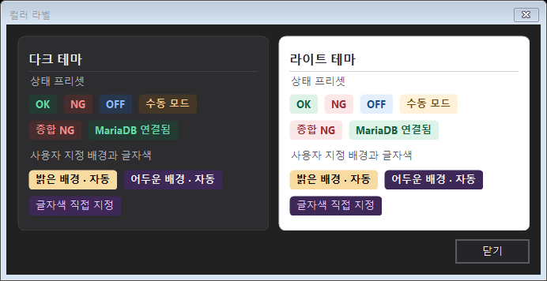

# ColorLabel (컬러 라벨)

연결 상태, 검사 판정, 운전 모드를 둥근 배지로 표시하는 WinForms `Label`이다. 카드 내부, 툴바, 결과 요약처럼 여러 위치에 독립적으로 배치할 수 있다.

## 결과 화면



## 디자이너에서

[카드 패널 설치](CardPanel.md#설치-및-디자이너-사용)와 동일한 `OmniSight.UI.dll`을 사용한다. VS2022 도구 상자에서 `ColorLabel`을 끌어 놓고 **OmniSight** 범주의 상태·테마·색을 설정한다. 일반 WinForms 속성 창에서 `Text`, `Font`, `TextAlign`, `AutoSize`, `AutoEllipsis`, `Padding`을 변경한다.

## 상태와 색

| 상태 | 예시 | 다크 배경 / 글자 | 라이트 배경 / 글자 |
| --- | --- | --- | --- |
| `Success` | OK, MariaDB 연결됨 | `#233B32` / `#63D9AA` | `#DDF3E7` / `#146140` |
| `Error` | NG, 종합 NG | `#482D2F` / `#F58A88` | `#FBE7E8` / `#9C3036` |
| `Info` | OFF | `#26374E` / `#88BAFF` | `#E4EFFD` / `#174D91` |
| `Warning` | 수동 모드 | `#443728` / `#FFD08A` | `#FFF1DA` / `#75480C` |

`Theme`과 `Tone`의 기본값은 `UiTheme.Dark`와 `BadgeTone.Info`다. `BadgeBackColor`와 `BadgeForeColor`에는 불투명 색 또는 `Color.Empty`를 넣는다.

- 두 색상이 `Color.Empty`이면 상태 표에 있는 배경과 글자색을 쓴다.
- `BadgeBackColor`만 지정하면 sRGB 상대 휘도로 계산해 대비가 더 높은 검정 또는 흰색을 선택한다.
- `BadgeForeColor`를 지정하면 자동 색상과 상태 색상보다 우선한다.

## 코드에서

```csharp
using System.Drawing;
using System.Windows.Forms;
using OmniSight.UI.Controls;

var badge = new ColorLabel
{
    Text = "MariaDB 연결됨",
    Theme = UiTheme.Dark,
    Tone = BadgeTone.Success
};
statusLayout.Controls.Add(badge);

// 검사 결과가 바뀌면 UI 스레드에서 갱신한다.
badge.Text = "종합 NG";
badge.Tone = BadgeTone.Error;
```

기본 글자는 가운데에 굵게 표시한다. `Font`로 글꼴과 크기를 지정하고 `Emphasized = false`로 설정하면 `Font`의 스타일을 그대로 사용한다. 96 DPI 기준으로 기본 최소 높이 24px, 좌우 9px·상하 4px 여백, 반경 5px를 적용한다. `CornerRadius = 0`이면 직각으로 그린다. 둥근 모서리 바깥은 부모의 단색 배경에 맞춰 그린다.

```csharp
badge.AutoSize = false;
badge.AutoEllipsis = true;
badge.Size = new Size(100, 26);
badge.Text = "수동 모드로 검사 중";
badge.BadgeBackColor = Color.FromArgb(62, 40, 88);
badge.BadgeForeColor = Color.Empty; // 어두운 배경에서 자동으로 흰색
badge.Emphasized = false;

// 글자색을 직접 지정하는 경우
badge.BadgeForeColor = Color.FromArgb(236, 202, 255);

// 상태 팔레트로 복원
badge.BadgeBackColor = Color.Empty;
badge.BadgeForeColor = Color.Empty;
```

## DataGridView 셀에 그리기

`ColorLabel.DrawBadge`는 동일한 배지 스타일을 지정한 영역에 그린다. `DataGridView.CellPainting`에서 사용하면 각 행에 개별 컨트롤을 만들 필요가 없다. 전달한 `Font`의 스타일을 사용하며, 호출자가 소유한 `Graphics`와 `Font`는 그대로 반환한다.

```csharp
resultsGrid.CellPainting += (sender, e) =>
{
    if (e.RowIndex < 0 || e.ColumnIndex != verdictColumn.Index)
        return;

    var text = e.FormattedValue as string;
    if (text != "OK" && text != "NG")
        return;

    int dpi = resultsGrid.DeviceDpi;
    int width = Math.Min(e.CellBounds.Width, (int)Math.Round(40 * dpi / 96d));
    int height = Math.Min(e.CellBounds.Height, (int)Math.Round(24 * dpi / 96d));
    var bounds = new Rectangle(e.CellBounds.Left + (e.CellBounds.Width - width) / 2,
        e.CellBounds.Top + (e.CellBounds.Height - height) / 2, width, height);

    e.PaintBackground(e.ClipBounds, true);
    var state = e.Graphics.Save();
    try
    {
        e.Graphics.SetClip(Rectangle.Intersect(e.ClipBounds, e.CellBounds),
            System.Drawing.Drawing2D.CombineMode.Intersect);
        ColorLabel.DrawBadge(e.Graphics, bounds, text, e.CellStyle.Font ?? resultsGrid.Font,
            currentTheme, text == "OK" ? BadgeTone.Success : BadgeTone.Error, dpi);
    }
    finally
    {
        e.Graphics.Restore(state);
    }
    e.Paint(e.ClipBounds, DataGridViewPaintParts.Focus);
    e.Handled = true;
};
```

## 데모와 검증

`OmniSight.UI.Demo`에서 **카드 패널·컬러 라벨 데모 → 컬러 라벨**을 열면 여섯 예시를 다크·라이트로 비교할 수 있다. 아래에는 밝은 배경과 어두운 배경의 자동 대비, 직접 지정한 글자색이 표시된다. `--check` 모드는 두 테마의 상태 렌더링과 자동 크기, 둥근 모서리, 사용자 지정 글자색의 우선순위를 검사한다.
