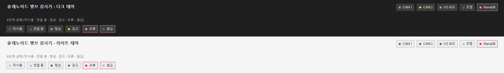
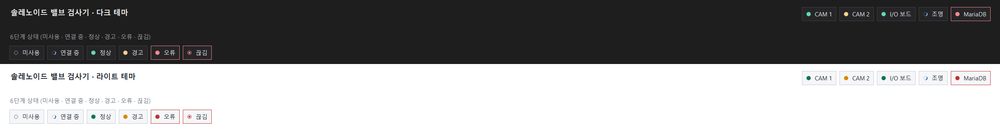
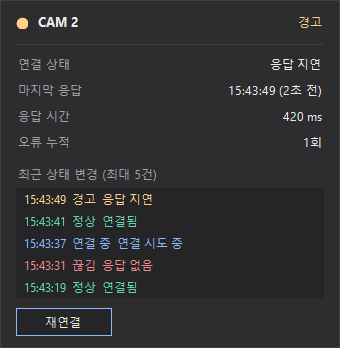
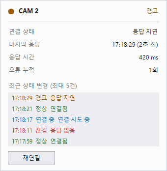

# DeviceStatusStrip (장치 상태 표시줄)

헤더에 놓는 한 줄짜리 컨트롤이다. 장치마다 **램프 + 이름 칩**을 하나씩 그리고, 칩을 누르면 상세 팝업이 열린다.
다크·라이트 테마를 지원하고, 깜박이지 않으며(더블 버퍼, 값이 바뀔 때만 다시 그림), 24시간 운전에서 핸들·메모리가 늘지 않도록 만들었다.

| 구성 | 역할 |
|---|---|
| `DeviceStatusStrip` | 헤더에 놓는 표시줄. 칩 배치, 타이머, 팝업, 테마를 관리한다. |
| `DeviceStatusChip` | 램프 + 이름 칩(표시줄이 만든다). |
| `DeviceStatusRegistry` | 장치 쪽이 상태를 보고하는 창구. 어느 스레드에서든 호출할 수 있다. |
| `DeviceStatusPopup` | 상세 팝업(연결 상태, 마지막 응답, 응답 시간, 오류 누적, 최근 변경 이력, 재연결). |
| `DeviceStatusPalette` / `UiTheme` | VS2022 다크·라이트 색. `UiTheme`은 `SquareButton`과 공용이다. |

## 결과 화면

1920x1080 기준(칩 높이 28, 글꼴 9pt). 위가 다크, 아래가 라이트이고, 각 영역의 아랫줄은 6단계 상태 범례다.



2560x1440 기준(칩 높이 36, 글꼴 11pt).



칩을 누르면 열리는 상세 팝업(왼쪽 다크, 오른쪽 라이트).

 

## 색

색은 **Visual Studio 2022의 다크·라이트 테마**와 같다. 설치된 VS의 테마 정의(`Theme.Dark.pkgdef`, `Theme.Light.pkgdef`)에서 읽은 값이고, 표의 이름은 그 파일의 토큰이다.

| 용도 | 다크 | 라이트 | VS 토큰 |
|---|---|---|---|
| 헤더 바탕 | `#1f1f1f` | `#f5f5f5` | Environment.ToolWindowBackground |
| 칩 바탕 / 테두리 | `#3d3d3d` / `#3d3d3d` | `#ececf0` / `#acacac` | CommonControls.Button / ButtonBorder |
| 마우스 올림 바탕 / 테두리 | `#4d4d4d` / `#4d4d4d` | `#c9def5` / `#006cbe` | ButtonHover / ButtonBorderHover |
| 팝업이 열린 칩 바탕 / 테두리 | `#333333` / `#999999` | `#c9def5` / `#2d2d2d` | ButtonFocused / ButtonBorderFocused |
| 글자 / 보조 글자 | `#fafafa` / `#b2b2b2` | `#1e1e1e` / `#717171` | Button 글자 / ToolWindowTabText·ToolTipHintText |
| 정상 램프 | `#6ccb5f` | `#2e7d32` | CommonDocument.StatusBannerSuccessBorder |
| 경고 램프 | `#fce100` | `#9d5d00` | StatusBannerWarningBorder |
| 오류·끊김 램프 | `#ff99a4` | `#d53230` | StatusBannerErrorBorder |
| 연결 중 호 / 바탕 고리 | `#83beeb` / `#424242` | `#006cbe` / `#d6d8dc` | ThemedDialog.Hyperlink / ToolWindowSplitBarBackground |
| 팝업 바탕 / 목록 / 테두리 | `#242424` / `#2e2e2e` / `#3d3d3d` | `#fbfbfb` / `#eeeef2` / `#cccedb` | ThemedDialog.WindowPanel / ToolWindowContentGrid / ToolWindowBorder |

팝업의 `재연결` 버튼은 `SquareButton`이라 같은 테마 값을 쓴다. VS 테마에 장치 상태용 토큰은 없으므로 램프 색은 VS의 상태 배너(성공·경고·오류) 테두리 색을 가져다 썼다.

## 상태 6단계

색만이 아니라 모양도 달라서 색을 구분하기 어려워도 알아볼 수 있다. 오류와 끊김 칩은 테두리도 빨간색이다.

| 상태 (`DeviceLinkState`) | 램프 | 의미 |
|---|---|---|
| `Disabled` 미사용 | 빈 원 | 사용하지 않는 장치 |
| `Connecting` 연결 중 | 회전하는 호 | 연결 시도 중 |
| `Connected` 정상 | 초록 채움 | 정상 응답 |
| `Warning` 경고 | 노랑 채움 | 응답 지연 |
| `Fault` 오류 | 빨강 채움 | 장치가 오류를 보고함 |
| `Lost` 끊김 | 빨강 이중 링 | 응답이 없음 |

## 사용법

### 1. 배치

Visual Studio에서 솔루션을 빌드한 뒤 툴박스에서 `DeviceStatusStrip`을 폼(헤더 패널)에 끌어 놓는다.
다른 프로젝트에서는 DLL을 참조한 뒤 툴박스의 "항목 선택"으로 추가한다. .NET Framework 프로젝트는 `net472` 폴더의 DLL을 참조한다.
디자이너에서는 장치가 없어도 6단계 샘플 칩이 보여서 모양과 크기를 바로 확인할 수 있다.

헤더 오른쪽 끝에 두려면 표시줄은 내용 크기에 맞춰 자동으로 커지므로(`AutoSize`) 다음 중 하나로 위치를 잡는다.
- `Dock = Right`인 패널 안에 놓기
- 코드에서 헤더 크기가 바뀔 때마다 `Location`을 다시 계산하기(데모의 `DemoSection.PlaceStrip` 참고)

### 2. 장치 등록

```csharp
strip.Theme = UiTheme.Dark;      // 또는 Light
strip.AddDevice("cam1", "CAM 1");
strip.AddDevice("cam2", "CAM 2");
strip.AddDevice("io",   "I/O 보드");
```

### 3. 상태 보고 (어느 스레드에서나 가능)

```csharp
// 카메라 스레드, 통신 스레드 등에서 호출한다. UI를 건드리지 않는다.
strip.Registry.Report("cam1", DeviceLinkState.Connecting);
strip.Registry.Heartbeat("cam1", latencyMs: 35);          // 응답이 올 때마다
strip.Registry.Report("io", DeviceLinkState.Fault, "채널 3 단선");
```

- `Heartbeat`는 응답이 왔음을 알린다. 연결 중이거나 끊김으로 보고된 장치는 정상으로 바뀐다.
- 마지막 응답 이후 `WarningAfter`(기본 3초)가 지나면 경고, `LostAfter`(기본 10초)가 지나면 끊김으로 자동으로 내려간다.
- 경고·끊김에서 정상으로 올라갈 때는 응답이 `PromoteAfter`(기본 0.5초) 동안 이어져야 한다. 상태가 흔들리지 않는다.
- 표시줄은 자기 타이머로 갱신한다(평소 250ms, 연결 중인 칩이 있을 때만 80ms). 소비 쪽에서 타이머를 연결할 필요가 없다.
- 현재 코드에서 곧바로 반영하려면 `strip.RefreshStatus()`를 UI 스레드에서 호출한다.

```csharp
strip.Registry.WarningAfter = TimeSpan.FromSeconds(2);
strip.Registry.LostAfter    = TimeSpan.FromSeconds(6);
```

### 4. 이벤트

```csharp
strip.DeviceClicked     += (s, e) => Log(e.DeviceName + " " + e.Info.State);
strip.ReconnectRequested += (s, e) => reconnect(e.DeviceId);   // 팝업의 재연결 버튼
strip.ShowDetailPopup = true;                                   // false면 팝업을 열지 않는다
strip.ShowDetail("cam2");                                       // 코드에서 팝업 열기
```

재연결 버튼은 이벤트만 올린다. 실제 재연결은 장치 쪽에서 처리한다.

### 5. 테마 바꾸기

```csharp
strip.Theme = UiTheme.Light;   // 칩과 열려 있는 팝업이 즉시 다시 칠해진다

strip.Palette.Ok = Color.SeaGreen;       // 색을 직접 바꾸려면
strip.RefreshPalette();
```

## 크기 조절

| 속성 | 기본값 | 설명 |
|---|---|---|
| `ChipHeight` | 28 | 칩 높이(px, 16~96). 램프 지름(높이의 약 32%)과 좌우 여백이 높이에 비례한다. |
| `Font` | 부모 글꼴 | 칩 글자 크기. 이름 길이에 맞춰 칩 폭이 정해진다. |
| `ChipSpacing` | 8 | 칩 사이 간격(px). |
| `AutoSize` | true | 칩 전체 폭·높이에 맞춰 표시줄 크기를 자동으로 맞춘다. |

권장값:

| 화면 | `ChipHeight` | `Font` | `ChipSpacing` | 램프 지름 |
|---|---|---|---|---|
| 1920x1080 | 28 | Segoe UI 9pt | 8 | 약 9px |
| 2560x1440 | 36 | Segoe UI 11pt | 8 | 약 11px |

```csharp
strip.ChipHeight = 36;
strip.Font = new Font("Segoe UI", 11F);
```

디자이너에서는 속성 창의 `OmniSight` 범주에서 `Theme`, `ChipHeight`, `ChipSpacing`을 조절하면 샘플 칩이 바로 바뀐다.

## 스레드와 수명

- `Registry`의 `Report`, `Heartbeat`, `GetInfo`, `GetHistory`는 스레드 안전하다. 장치 스레드가 UI를 직접 건드리지 않는다.
- `AddDevice`, `RemoveDevice`, `Theme`, `ChipHeight`, `RefreshStatus`(핸들이 있을 때 다른 스레드에서 부르면 UI 스레드로 넘어간다)는 UI 스레드에서 사용한다.
- 브러시·펜·글꼴은 필드로 캐시하고 `Dispose`에서 해제한다. 상태 변경 이력은 장치당 50건의 원형 버퍼다.
- 칩은 값이 바뀔 때만 다시 그린다. 연결 중 회전 호는 램프 영역(약 9×9px)만 다시 그린다.

## 확인 방법

데모가 같은 내용을 확인한다.

```
dotnet build OmniSight.UI.sln -c Release
samples/OmniSight.UI.Demo/bin/x64/Release/net472/OmniSight.UI.Demo.exe --check
samples/OmniSight.UI.Demo/bin/x64/Release/net472/OmniSight.UI.Demo.exe --capture docs/images
```

- `--check`: 6개 상태 × 2개 테마 × 2개 크기의 칩 모서리·램프 중심 픽셀, 같은 값 반복 시 다시 그리지 않음, 자동 강등·승격, 다중 스레드 보고, 디자인 모드 렌더, 수만 번 갱신 후 GDI·USER 핸들과 메모리 증가 없음을 확인한다.
- `--capture <폴더>`: 이 문서의 결과 화면 이미지를 다시 만든다.

## 알려진 한계

- 지연·마지막 응답 값은 실제 장치 어댑터가 `Report`/`Heartbeat`로 채워야 한다. 기본 임계값(3초, 10초)은 임시이므로 현장 사양에 맞춰 조정한다.
- 실제 Visual Studio 디자이너에서의 표시는 직접 열어 확인해야 한다. 디자이너는 빌드된 DLL을 읽으므로 솔루션을 먼저 빌드한다.
