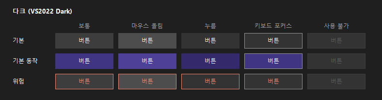
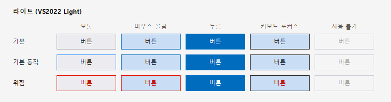
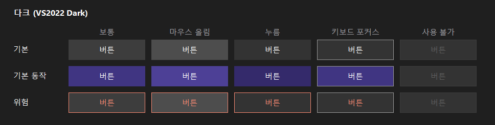
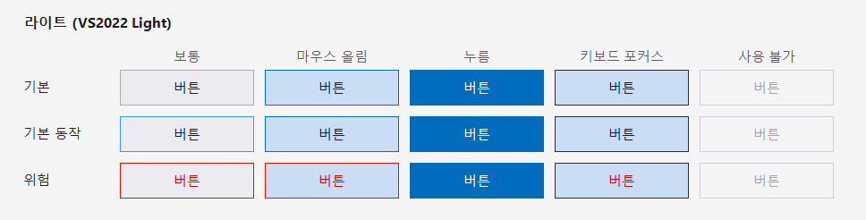

# SquareButton (각진 버튼)

각진 사각형 버튼 컨트롤이다. 색은 **Visual Studio 2022의 다크·라이트 테마**와 같고, 클릭·마우스 올림·포커스 때 가장자리에 시스템 색이나 흰 선이 비치지 않는다.

- Win32 `Button`을 상속하지 않는다. 전체 영역을 정수 좌표로 직접 칠하고 1px 테두리를 안쪽에 그린다(안티앨리어싱·반픽셀 없음, 부모 색에 의존하지 않음).
- 더블 버퍼이고, 브러시·펜은 캐시하며, 상태가 바뀔 때만 다시 그린다. 타이머가 없다.
- `IButtonControl`을 구현해서 `Form.AcceptButton`/`CancelButton`, `DialogResult`, `PerformClick`이 `Button`처럼 동작한다.

## 결과 화면

1920x1080 기준(글꼴 9pt, 높이 32). 행은 변형(기본·기본 동작·위험), 열은 상태다.




2560x1440 기준(글꼴 11pt, 높이 40).




## 색

VS2022 설치본의 테마 정의(`Common7\IDE\CommonExtensions\Platform\Theme.Dark.pkgdef`, `Theme.Light.pkgdef`의 `CommonControls` 범주)에서 읽은 값이다. 표의 `Button*`는 그 파일의 토큰 이름이다.

| 상태 | 다크 바탕 / 테두리 / 글자 | 라이트 바탕 / 테두리 / 글자 |
|---|---|---|
| 보통 (`Button`) | `#3d3d3d` / `#3d3d3d` / `#fafafa` | `#ececf0` / `#acacac` / `#1e1e1e` |
| 마우스 올림 (`ButtonHover`) | `#4d4d4d` / `#4d4d4d` / `#fafafa` | `#c9def5` / `#006cbe` / `#1e1e1e` |
| 누름 (`ButtonPressed`) | `#333333` / `#333333` / `#fafafa` | `#006cbe` / `#006cbe` / `#ffffff` |
| 키보드 포커스 (`ButtonFocused`) | `#333333` / `#999999` / `#fafafa` | `#c9def5` / `#2d2d2d` / `#1e1e1e` |
| 사용 불가 (`ButtonDisabled`) | `#333333` / `#3d3d3d` / `#5c5c5c` | `#f5f5f5` / `#cccedb` / `#a2a4a5` |

변형:

| 변형 | 설명 |
|---|---|
| `Default` 기본 | 일반 버튼. 위 표 그대로. |
| `Primary` 기본 동작 | VS의 `ButtonDefault`. 다크는 바탕·테두리 `#403582`. 라이트는 바탕은 일반과 같고 테두리만 `#3399ff`. |
| `Danger` 위험 | 중지·삭제·초기화용. 바탕은 일반과 같고 글자·테두리만 오류색(다크 `#f48771`, 라이트 `#e51400`/글자 `#c21000`). |

**직접 정한 값**: 위험 변형의 색과, 다크 기본 동작의 올림(`#4d4096`)·누름(`#342a6b`)은 VS 테마 파일에 없어서 직접 정했다. 나머지는 파일에서 읽은 값이다. 포커스는 점선 사각형 없이 VS처럼 테두리 색 변경으로만 표시하고, 키보드로 포커스가 들어왔을 때만 보인다.

## 사용법

### 디자이너에서

솔루션을 빌드한 뒤 툴박스에서 `SquareButton`을 끌어 놓는다. 속성 창의 `OmniSight` 범주에서 `Theme`(Dark/Light), `Variant`(Default/Primary/Danger), `IsToggle`, `Image`, `TextAlign`을 바꾼다.
.NET Framework 프로젝트는 `net472` 폴더의 DLL을 참조한다. 디자이너는 빌드된 DLL을 읽으므로 먼저 빌드해야 한다.

### 코드에서

```csharp
var start = new SquareButton { Text = "검사 시작", Theme = UiTheme.Dark, Variant = SquareButtonVariant.Primary };
start.Click += (s, e) => StartInspection();

var stop = new SquareButton { Text = "검사 중지", Theme = UiTheme.Dark, Variant = SquareButtonVariant.Danger };

// 대화 상자
var ok = new SquareButton { Text = "확인", DialogResult = DialogResult.OK, Variant = SquareButtonVariant.Primary };
form.AcceptButton = ok;

// 토글(켜짐·꺼짐)
var live = new SquareButton { Text = "라이브", IsToggle = true };
live.CheckedChanged += (s, e) => SetLive(live.Checked);
```

### 테마 바꾸기

```csharp
button.Theme = UiTheme.Light;        // VS2022 라이트 색으로 즉시 바뀐다

button.Palette.Set(SquareButtonVariant.Default, SquareButtonState.Normal,
    new SquareButtonColors(back, border, text));   // 색을 직접 바꾸려면
button.RefreshPalette();
```

화면의 모든 버튼을 한꺼번에 바꾸려면 폼의 `Controls`를 훑어 `SquareButton`의 `Theme`을 바꾼다.

## 크기 조절

| 속성 | 기본값 | 설명 |
|---|---|---|
| `Size` / `Height` | 100 x 32 | 버튼 크기. 자동 크기가 필요하면 `GetPreferredSize`를 쓴다. |
| `Font` | 시스템 메시지 글꼴 | 글자 크기. |
| `Padding` | 0 | 좌우 안쪽 여백(기본 12px는 별도로 항상 적용). |
| `TextAlign` | 가운데 | 왼쪽(`MiddleLeft` 등) 또는 가운데. |

권장값:

| 화면 | 높이 | 글꼴 | 폭 예시 |
|---|---|---|---|
| 1920x1080 | 32 | Segoe UI 9pt | 120 |
| 2560x1440 | 40 | Segoe UI 11pt | 150 |

```csharp
button.Height = 40;
button.Font = new Font("Segoe UI", 11F);
```

## 확인 방법

```
dotnet build OmniSight.UI.sln -c Release
samples/OmniSight.UI.Demo/bin/x64/Release/net472/OmniSight.UI.Demo.exe --check
samples/OmniSight.UI.Demo/bin/x64/Release/net472/OmniSight.UI.Demo.exe --capture docs/images
```

- `--check`: VS 테마 값 대조, 3변형 × 5상태 × 2테마 × 2크기의 모서리·안쪽 픽셀(부모 색이 마젠타여도 비치지 않음), 같은 값을 반복 설정해도 다시 그리지 않음, 입력·`DialogResult`·토글, 디자인 모드 렌더, 10,000회 상태 변경 후 GDI·USER 핸들과 메모리 증가 없음.
- `--capture <폴더>`: 이 문서의 결과 화면을 다시 만든다.
- `ForcedState` 속성은 입력과 상관없이 시각 상태를 고정한다(문서 캡처·화면 확인용).

## 알려진 한계

- VS 테마 값은 설치된 VS2022(17.x) 기준이다. VS 색이 바뀌면 `SquareButtonPalette`를 갱신한다.
- 실제 Visual Studio 디자이너 화면은 직접 열어 확인해야 한다(`DesignSurface`로만 간접 확인했다).
- 캡처 이미지의 글자 가장자리 색 번짐은 ClearType 렌더링 때문이며 실제 화면에서도 같은 방식으로 그려진다.
